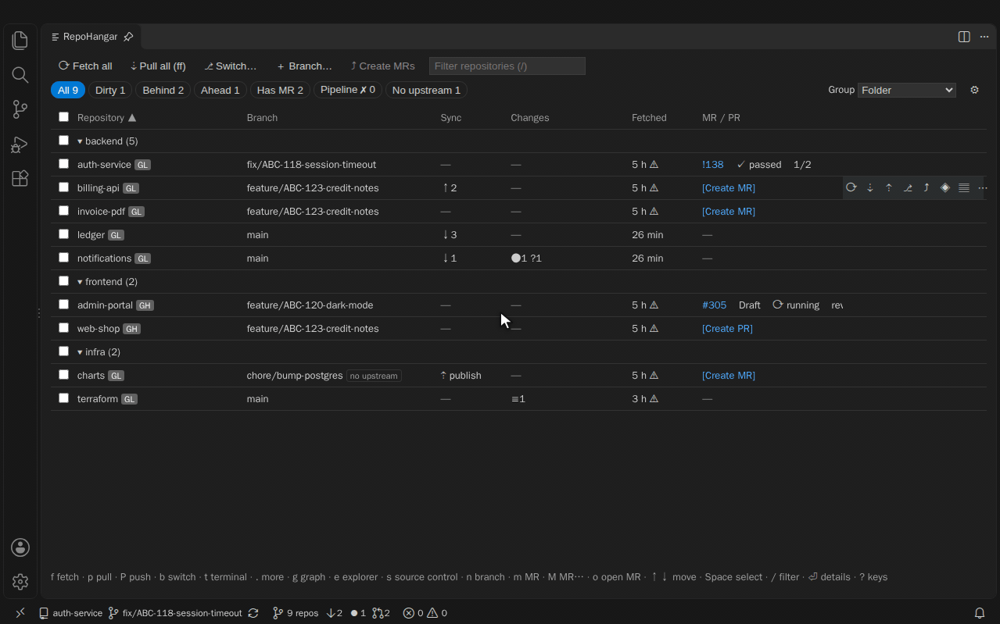
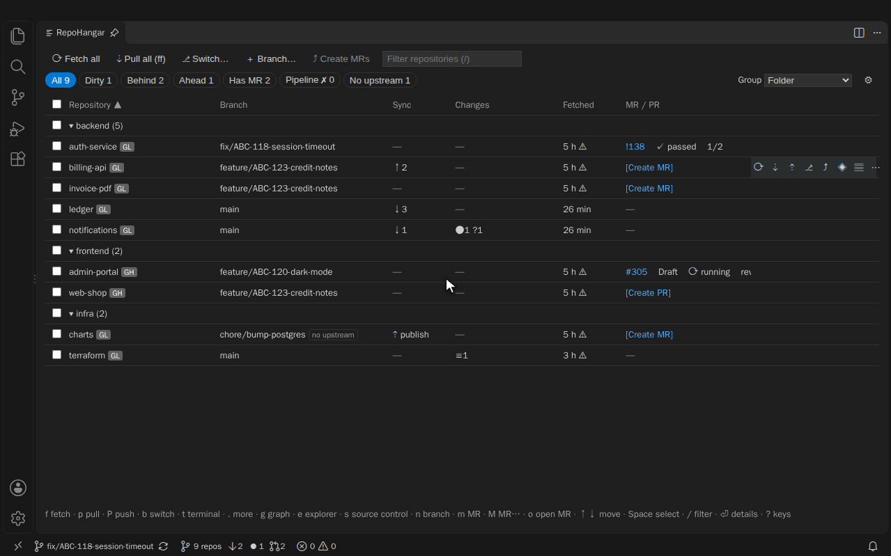
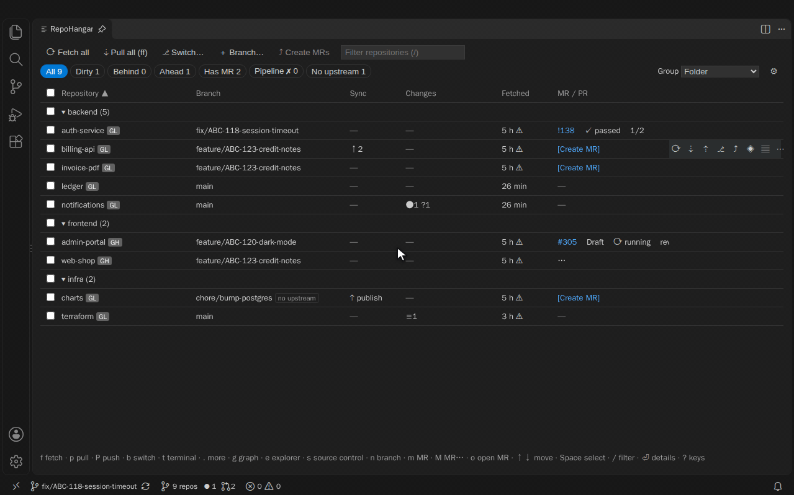
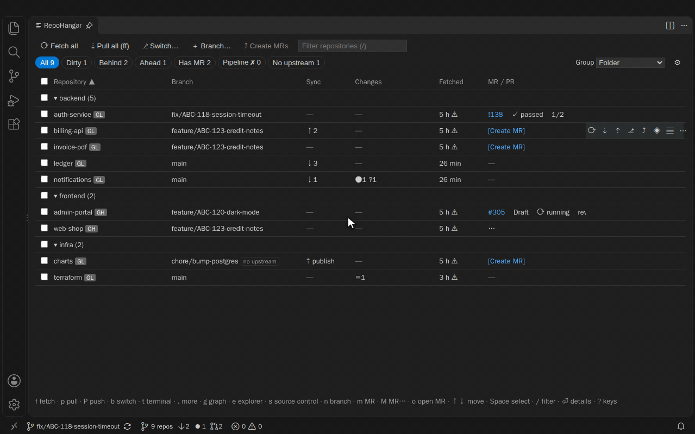
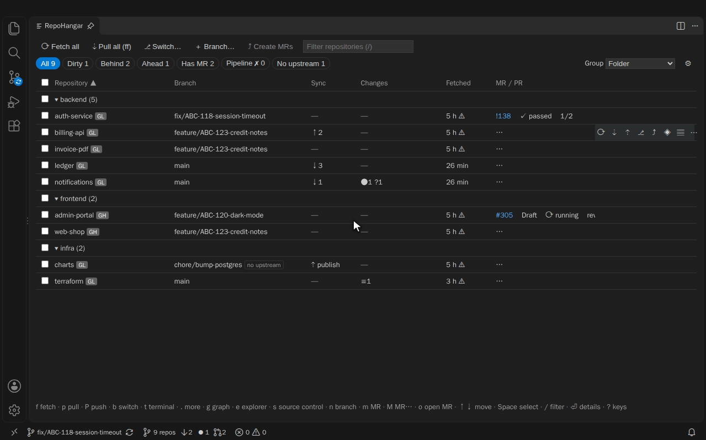
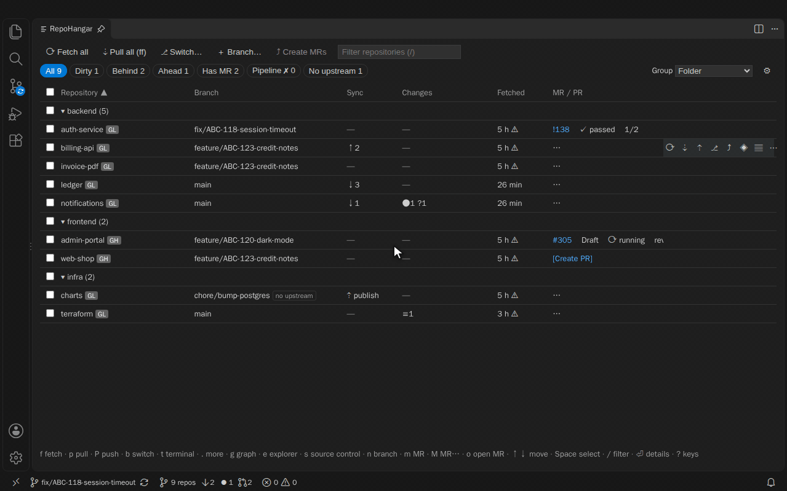
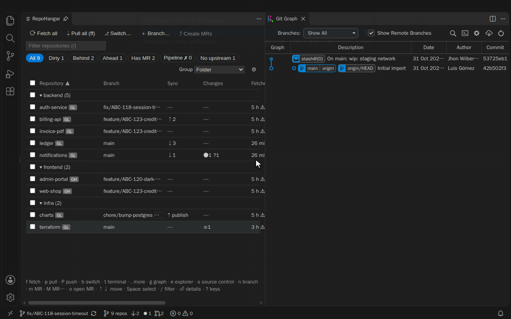

# RepoHangar - Multi-Repo Git Dashboard

See every Git repository in your workspace at a glance, act on all of them at once, and open GitLab merge requests
or GitHub pull requests with your team's defaults in one keystroke.

> RepoHangar is in preview. Dashboard operations, multi-repo branch switching/creation, MR profiles, and single or
> linked batch merge/pull request creation are available today; auto-merge follows.

## Dashboard



Run **RepoHangar: Open Dashboard** (`Ctrl+Alt+H`, `Ctrl+Cmd+H` on macOS), click the status bar summary, or click
**Open RepoHangar** in the Source Control title bar. The dashboard has one row per repository that the built-in Git
extension opened:

| Column | Shows |
|---|---|
| Repository | Name and host (`GL` GitLab, `GH` GitHub, `?` unknown); the tooltip has the path and the remote URL |
| Branch | Branch name and a `no upstream` badge, or `detached a1b2c3d`, `REBASING 3/7`, `MERGING`, `CHERRY-PICKING`, `REVERTING` |
| Sync | `↑ahead ↓behind`, `⇡ publish` for unpublished branches, `—` when there is nothing to sync |
| Changes | `⚠ n confl`, `●` unstaged, `+` staged, `?` untracked, `≡` stashes |
| Fetched | Time since the last fetch, `⚠` when older than `repohangar.staleFetchHours` |
| MR / PR | The open merge request (`!142`) or pull request (`#311`) of the branch, `Draft`, the pipeline or checks (`✓ passed`, `⟳ running`, `◷ pending`, `✗ failed`), approvals (`1/2` on GitLab, `changes requested` on GitHub) and `auto ⇢`; `Sign in` when the host has no credential, `?` for an unknown host |

Rows update as soon as the Git extension sees a change; RepoHangar never polls.

Click a column header to sort the rows within each group: the first click puts what needs attention on top (most
behind, most changes, oldest fetch, failed pipeline; A→Z for names), a second click reverses it, and a third click
goes back to repository name A→Z. The sort is remembered for the workspace.

The checkbox on a group header selects every repository of the group that the filter shows (`−` when only some are
selected), and the checkbox above the rows does the same for every repository the filter shows. Shift+click a row's
checkbox to select every row from the last one you clicked.

### Keys

| Key | Action |
|---|---|
| `↑` `↓` / `j` `k` | Move |
| `Space` | Toggle selection of the focused row, or of every row of the focused group |
| `Ctrl+A` | Select all shown rows |
| `/` | Filter by name, branch or group |
| `S` | Sort: focus the column headers, then `←` `→` and `Enter`; `↓` or `Esc` returns to the rows |
| `Enter` | Row details, or collapse a group |
| `1` – `7` | Chips All, Dirty, Behind, Ahead, Has MR, Pipeline ✗, No upstream |
| `Esc` | Clear the filter, then the selection |
| `?` | Key help |
| `g` | Open the focused row in Git Graph (or the Source Control Graph) |
| `e` | Reveal the focused row in the Explorer |
| `s` | Show the focused row in Source Control |
| `m` | Create the merge request or pull request of the focused row with its profile's defaults, or one per selected row, linked to each other |
| `M` | Open the Create MR drawer for the focused row |
| `o` | Open the merge request or pull request of the focused row |
| `b` | Switch branch in the focused row with VS Code's branch picker, or in the selected rows |
| `n` | Create a branch in the focused row, or in the selected rows |

A click on a repository name opens it in Git Graph when Git Graph is installed, else reveals it in the Explorer
(`repohangar.dashboard.nameClick`); a click on the Changes cell shows it in Source Control.

The `⋯` button at the right of a hovered row (or `.`) opens its menu: Open in Git Graph, Reveal in Explorer, Show in
Source Control, Open terminal, the stash and discard actions, Reveal in File Explorer, Copy path, Copy branch name and
Open compare page. A right-click anywhere on the row opens the same menu at the pointer.

### Switch or create a branch across repositories



Select the repositories of a feature and press `b`, click **⎇ Switch…** in the toolbar or run **RepoHangar: Switch
Branch in Repositories…** (`repohangar.switchBranch`). One quick pick lists the branches those repositories have, the
most common first, with where each one is: `local in 2 · remote in 1 (tracking branch will be created)`. A branch only
on the remote becomes a tracking branch; a repository without the branch is skipped. The list comes from local refs, so
run **Fetch all** first to see branches that only exist on the server.

When some repositories have uncommitted changes, RepoHangar asks once: **Skip** (the default), **Stash and switch**
(`git stash push --include-untracked` with the message `RepoHangar: before switching to <branch>`; the stash is kept for
you to pop) or **Switch anyway** (Git refuses a checkout that would overwrite your changes). `Esc` cancels everything.

To start a feature, press `n`, click **＋ Branch…** or run **RepoHangar: Create Branch in Repositories…**
(`repohangar.createBranch`) and type the name once: it is checked with `git check-ref-format --branch`, then created
and checked out from the current HEAD of each repository. Typing a new name in the switch quick pick offers
`＋ Create "<name>" from current HEAD in all <n>` as well. Without a selection, the commands and toolbar buttons act on
every repository; `n` acts on the focused row.

### Batch results



When Fetch all, Pull all (ff), Switch or Create ends with a skipped or failed repository, a panel above the grid lists
every repository with its result, failures first, and a button to fix it: **Stash and pull**, **Pull with rebase**,
**Publish**, **Open SCM**, **Show Git Output**, **Stash and switch** or **Create branch here**. **Retry failed** runs
the same batch again on the failed repositories only. A batch started from the Command Palette offers the panel with
**Show Details** in its summary notification.

## Merge requests and pull requests

The **MR / PR** column shows the open merge request (GitLab) or pull request (GitHub) of each repository's branch. It
costs one GraphQL request per host for every repository on it, and RepoHangar asks again only when something changed:
a commit or branch switch, a push from RepoHangar, the window gaining focus after 60 s, every
`repohangar.providers.refreshMinutes` while a pipeline runs, and **RepoHangar: Refresh**. Nothing is sent while the
window is unfocused. The last values are kept, so the dashboard opens with them, dimmed until they are refreshed.

A click on `!142` or `#311`, `o`, or **RepoHangar: Open Merge Request of Current Branch** opens it in the browser;
**RepoHangar: Copy Merge Request Link** copies it. Row details add the merge request, its pipeline or checks, **Copy
link** and **Compare with main**; the `⋯` menu has **Open compare page**.

Hosts: `github.com` and `gitlab.com` are known; a self-hosted host is asked once (`/api/v4/version`, then
`/api/v3/meta`, without credentials), or you choose with the `?` cell, which writes `repohangar.hosts`. RepoHangar
warns once about a GitLab older than 17.10.

### Signing in

| Host | How RepoHangar gets a credential |
|---|---|
| github.com | Your VS Code GitHub account (`repo` scope); click `Sign in` if you are not signed in |
| GitHub Enterprise | The VS Code account of `github-enterprise.uri`, a stored token, or your `gh` login |
| GitLab (gitlab.com or self-hosted) | A stored token, else your `glab` login; `Sign in` opens the token page with the name `RepoHangar` and the `api` scope pre-filled, then asks you to paste the token |

The first time the dashboard opens, a panel lists your hosts and how each is connected, with **Skip — git only** for
hosts you do not want RepoHangar to contact. **RepoHangar: Sign In to Host…** and **Sign Out of Host…** do the same
later.

Tokens are kept only in VS Code's secret storage, per host, and sent only to their own host. They never reach
settings, logs or the dashboard. A token the host rejects is deleted and RepoHangar asks you to sign in again.

## Creating merge requests and pull requests



Press `m` on a row, click **[Create MR]** (**[Create PR]** on GitHub) in its MR / PR cell or `⤴` in its hover
buttons, or run **RepoHangar: Create Merge Request (Defaults)** (`Ctrl+Alt+M`, `Ctrl+Cmd+M` on macOS) on the
repository of the active editor. RepoHangar opens the **Create MR drawer** (below), every field filled in from the
repository's MR profile, so you can check them and press `Ctrl+Enter`. With `repohangar.mr.quickCreate` set to
`"direct"`, it creates the merge request with those values and no dialog. Either way, creating it does this:

1. It asks the host once whether the branch already has one, and opens it instead of creating a duplicate.
2. It stops, with a button that fixes it, when the branch is not ready: an operation in progress, a detached HEAD, the
   target branch itself, nothing to merge, or a remote branch with commits you don't have. Uncommitted files only add
   a warning.
3. It pushes the branch when it has no upstream or is ahead of it (`"pushIfNeeded": false` stops instead).
4. It sends every value in the create request and reports what was applied:
   `Created !142 in billing-api (pushed 2 commits): reviewers ana.perez, luis.gomez · squash · delete branch`, with
   **Open MR**, **Copy link** and **Undo**. Undo closes the merge request within 30 s and keeps the branch.

The Sync cell shows `⟳ creating MR` while it runs; pressing `m` again does nothing. With `repohangar.mr.quickCreate`
set to `"confirm"`, `m`, **[Create MR]**, the hover button and `Ctrl+Alt+M` show a quick input instead: `Enter` creates
with the title you typed, and it offers **Edit all fields…**, the other profiles and **Create as draft**.

`M` and **RepoHangar: Create Merge Request…** (`Ctrl+Alt+Shift+M`, `Ctrl+Cmd+Shift+M` on macOS) always open the
**Create MR drawer** beside the grid, opening the dashboard first when it is closed, every field filled in from the profile: profile, target, title, description, reviewers,
assignees, labels, squash, delete source branch and draft. Under **Reviewers** and **Labels**, `recent: luis.gomez ·
team:backend` offers the last 10 you sent on that host, one click each. In **Reviewers** and **Assignees**, type part of
a name or username and pick from the list of the project's users (`Jhon Tapia @jtapia`): `↑` `↓` move,
`Enter` or a click adds the username, `Esc` closes the list. `Enter` with no match adds what you typed (a leading `@`
is dropped), so `team:<slug>` still works on GitHub. On GitHub the search matches names as well as logins.
`Ctrl+Enter` creates, `Esc` closes it. **Create MR**,
**Create MR…** and **Open MR** are also in the Source Control Repositories menu and the Explorer **RepoHangar**
submenu of GitLab and GitHub repositories.

### Merge requests for several repositories



Select the repositories of a feature (filter by its ticket and press `Ctrl+A`) and press `m`, click **⤴ Create MRs (3)**
in the toolbar, or run **RepoHangar: Create Merge Request (Defaults)** while the dashboard has rows selected. RepoHangar
creates one merge request or pull request per repository, in parallel, each with the profile its own rules choose and
its own checks: a repository that is not ready is skipped with its reason, and the others go on. One quick pick lists
them all first; with `repohangar.mr.quickCreate` set to `"direct"`, they are created with no dialog.

When they are created, each description gets a **Related:** section that links the others, on GitLab and GitHub alike:

```text
Related:
- ledger !143 https://git.acme.com/payments/ledger/-/merge_requests/143
- web-shop #311 https://github.com/acme/web-shop/pull/311
```

It goes where the description has `{related}`, else at the end, between hidden markers, so creating the set again
replaces it instead of adding a second one. A review that already existed is linked too; one created on GitLab without
a token is not. The result panel lists every repository (`✓ billing-api  !142  git.acme.com/payments/billing-api
(pushed 2)`) with **Open ↗**, **Copy all links**, **Retry failed** for the ones that failed, which links all of them
again, and **Close**.

### MR profiles

A profile is a named set of defaults in `repohangar.mr.profiles`, at user scope (yours, every workspace) or workspace
scope (shared with the team); a workspace profile overrides the user profile of the same name key by key.
`repohangar.mr.rules` chooses a profile per repository and branch: the first rule whose globs match wins, and its
`set` overrides values of that profile.

You rarely need to write them by hand:

- **The profile editor.** **RepoHangar: Edit MR Profiles**, the `⚙` button of the dashboard toolbar, or **Set up a
  default profile** in the first-run panel open a form with a **User** / **Workspace** switch. It lists the profiles of
  that scope (`★ default` first), the rules in order (**New rule**, move, delete) and every field of the selected
  profile, with a live preview of the title for the focused dashboard row. A field the profile does not set shows the
  inherited value, dimmed, with *Inherited from …* as its tooltip. **Reviewers** and **Assignees** search users like
  the drawer, in the repository chosen in **Search users in** (the focused dashboard row's repository when it is on
  GitLab or GitHub, else the first one by name). **Save** writes that scope only, through VS Code's
  own settings editing, so the rest of `settings.json` and its comments stay as they are (comments *inside* the
  `repohangar.mr.profiles` value are not kept; use **Open settings.json** for those). If the settings change elsewhere
  while you have unsaved edits, the editor asks before reloading.
- **Save as defaults ▾** in the Create MR drawer keeps the reviewers, assignees, labels, squash, delete source branch
  and draft values that differ from the profile, without the title, description or target:

  | Item | Saved to |
  |---|---|
  | **For me (all workspaces)** | the profile at user scope |
  | **For this workspace (shared)** | the profile at workspace scope (`.vscode/settings.json` or the `.code-workspace` file) |
  | **For this repo only** | this repository, on this machine and in this workspace only |

  What a repository remembers is applied after the rule's `set` and before your edits in the drawer. The profile
  editor lists it (`billing-api → reviewers +carla.ruiz`) with **Forget**.

```jsonc
"repohangar.mr.profiles": {
  "default": {
    "target": "{defaultBranch}",
    "reviewers": ["ana.perez", "luis.gomez"],
    "assignees": ["@me"],
    "labels": ["needs-review"],
    "squash": true,
    "deleteSourceBranch": true,
    "draft": false,
    "title": "{type}: {ticket} {branchTitle}",
    "description": "template:default",   // the repository's template, else the commit list
    "pushIfNeeded": true,
    "openAfterCreate": "notify"           // "notify" | "browser" | "none"
  },
  "hotfix": {
    "extends": "default",
    "target": "release/{latestRelease}",
    "reviewers": ["team:sre", "ana.perez"],
    "labels": ["hotfix"]
  }
},
// Matched against "<host>/<project path>" and the branch; the first match wins.
"repohangar.mr.rules": [
  { "branch": "hotfix/**", "profile": "hotfix" },
  { "repo": "git.acme.com/payments/**", "profile": "default", "set": { "reviewers": ["carla.ruiz"] } },
  { "repo": "github.com/acme/web-*", "profile": "default", "set": { "labels": ["frontend"] } }
]
```

Reviewers and assignees are usernames; `@me` is you on that host, you are never your own reviewer, and `team:<slug>`
is a GitHub team (left out on GitLab, with a note). A GitLab project that turns squash off or requires it wins over
the profile, and the drawer says so. GitLab Free keeps one reviewer; RepoHangar reports the ones it could not add.

Titles and descriptions take these placeholders, shown for the branch `feature/ABC-123-add-billing-notes`:

| Placeholder | Value |
|---|---|
| `{branch}` | `feature/ABC-123-add-billing-notes` |
| `{type}` | `feat`, from the branch prefix through `repohangar.mr.typeMap` |
| `{ticket}` | `ABC-123`, the first match of `repohangar.mr.ticketPattern`; empty without one |
| `{branchTitle}` | `Add billing notes` |
| `{firstCommit}` | The subject of the first commit ahead of the target |
| `{commits}` | The subjects of the commits ahead of the target, one bullet each (at most 30) |
| `{repo}` | `billing-api` |
| `{defaultBranch}` | `main` |
| `{latestRelease}` | The highest `release/*` branch of the remote, by version |
| `{me}` | Your username on the host |
| `{related}` | The links to the other merge requests created with it (see *Merge requests for several repositories*); empty for one repository |

With exactly one commit ahead and the default title, the commit subject is the title. `template:default` uses the
repository's own template (`.gitlab/merge_request_templates/Default.md`, `.github/pull_request_template.md`), read from
the working tree, and `template:<name>` another one of `.gitlab/merge_request_templates/` or
`.github/PULL_REQUEST_TEMPLATE/`.

### GitLab without a token

When a GitLab host has no token, RepoHangar creates the merge request during the push, with GitLab's push options
(`repohangar.gitlab.usePushOptions`: `"whenNoToken"` by default, `"always"` or `"never"`). The push runs `git push`
with your credential helper or SSH key and sets target, title, a one-line description, draft, labels, the first
assignee, squash and delete source branch. Push options cannot set reviewers, a description with line breaks or more
than one assignee, and a branch that is already pushed cannot get its merge request that way. The result says what was
left out and offers **Connect `<host>`**: sign in, and RepoHangar adds the reviewers to that merge request.

## Git Graph



**Open in Git Graph** opens the [Git Graph](https://marketplace.visualstudio.com/items?itemName=mhutchie.git-graph)
extension switched to the repository: `g` or the `◈` button on a row, the row's `⋯` menu and details, the Source
Control Repositories menu, the Explorer context menu, and **RepoHangar: Open in Git Graph** (`Ctrl+Alt+J`,
`Ctrl+Cmd+J` on macOS) for the repository of the active editor. Source Control is shown next to the graph with the
same repository selected, and keyboard focus stays on Git Graph.

With the dashboard on one side and Git Graph on the other, each click on a repository name shows that repository's
graph:



Git Graph is optional. Without it the same items read **Open in Source Control Graph** and open VS Code's built-in
graph (`repohangar.gitGraph.whenMissing`: `"offerInstall"` keeps **Open in Git Graph** and offers to install it,
`"hide"` hides the items). RepoHangar installs nothing unless you click **Install Git Graph**. VS Code's Source Control
Graph shows the repository of its own Repo picker, so pick the repository there if it shows another one.

## Explorer

**Reveal in Explorer** (`e`, the `▤` button, the `⋯` menu, the row details, the Source Control Repositories menu, or
**RepoHangar: Reveal Repository in Explorer**) shows the repository folder in the Explorer. For a repository outside
the workspace folders RepoHangar asks whether to add it to the workspace, open it in a new window or reveal it in the
file manager; **Always do this** remembers the choice in `repohangar.explorer.outsideWorkspace`.

Right-click a repository folder in the Explorer for **Open in Git Graph** and the **RepoHangar** submenu: **Show in
RepoHangar**, **Fetch** and **Pull (ff)**. RepoHangar finds repository folders down to
`repohangar.repositoryScanDepth` levels below each workspace folder, including repositories the Git extension did not
open; **RepoHangar: Refresh** scans again after a clone. Set `repohangar.explorer.contextMenu.showOn` to
`"allFolders"` to get the items on every folder, for the repository that contains it.

## Source Control

**Show in Source Control** (`s`, a click on the Changes cell, the `⋯` menu, the row details, or **RepoHangar: Show
Repository in Source Control**) shows Source Control with the repository selected. Selecting a repository needs
`scm.repositories.selectionMode` set to `single`; VS Code has no API for it, so RepoHangar uses its internal commands
and writes any failure to the **RepoHangar** output channel instead of showing an error.

## Moving from Git Graph Opener

RepoHangar includes Git Graph Opener. On its first start it copies the `gitGraphOpener.*` settings to their
`repohangar.*` keys at every scope where you set them, and leaves the old keys in place. While Git Graph Opener is
installed, RepoHangar hides its own Explorer item and offers once to uninstall Git Graph Opener.

| Git Graph Opener | RepoHangar |
|---|---|
| `gitGraphOpener.contextMenu.showOn` | `repohangar.explorer.contextMenu.showOn` |
| `gitGraphOpener.repositoryScanDepth` | `repohangar.repositoryScanDepth` |
| `gitGraphOpener.sourceControl.reveal` | `repohangar.gitGraph.revealSourceControl` |
| `gitGraphOpener.sourceControl.syncSelection` | `repohangar.gitGraph.syncSourceControlSelection` |

## Settings

| Setting | Default | Description |
|---|---|---|
| `repohangar.openOnStartup` | `"never"` | `"multiRepo"` opens the dashboard when 3 or more repositories are found |
| `repohangar.groupBy` | `"parentFolder"` | `parentFolder`, `workspaceFolder`, `custom` or `none` |
| `repohangar.groups` | `{}` | Custom groups: name → globs on the repository root path |
| `repohangar.staleFetchHours` | `1` | Age that marks the last fetch as stale; `0` turns the marker off |
| `repohangar.statusBar.enabled` | `true` | Show the status bar summary |
| `repohangar.hosts` | `{}` | Provider of self-hosted hosts, for example `{ "git.acme.com": "gitlab" }`; entries of user and workspace settings add up |
| `repohangar.providers.refreshMinutes` | `3` | Minutes between status refreshes while a pipeline runs and the window is focused |
| `repohangar.dashboard.nameClick` | `"auto"` | What a click on a repository name does: `auto` (Git Graph when installed, else the Explorer), `explorer`, `gitGraph` or `sourceControl` |
| `repohangar.gitGraph.whenMissing` | `"sourceControlGraph"` | Without Git Graph: `sourceControlGraph`, `offerInstall` or `hide` |
| `repohangar.gitGraph.revealSourceControl` | `true` | Show Source Control after Open in Git Graph |
| `repohangar.gitGraph.syncSourceControlSelection` | `true` | Select the repository in Source Control after Open in Git Graph |
| `repohangar.explorer.contextMenu.showOn` | `"repositoryRoots"` | Explorer folders with the RepoHangar items: `repositoryRoots` or `allFolders` |
| `repohangar.explorer.submenu` | `true` | Show the RepoHangar submenu in the Explorer context menu |
| `repohangar.explorer.collapseBeforeReveal` | `false` | Collapse the Explorer before Reveal in Explorer |
| `repohangar.explorer.outsideWorkspace` | `"ask"` | Reveal outside the workspace folders: `ask`, `addToWorkspace`, `newWindow` or `revealInOS` |
| `repohangar.repositoryScanDepth` | `3` | Folder levels scanned for repository folders below each workspace folder; `0` scans only the folder itself |
| `repohangar.mr.profiles` | `{ "default": {} }` | MR profiles: named defaults for new merge requests and pull requests |
| `repohangar.mr.rules` | `[]` | Rules that choose a profile by repository (`<host>/<project path>` glob) and branch glob |
| `repohangar.mr.quickCreate` | `"drawer"` | What `m`, **[Create MR]**, `⤴`, `Ctrl+Alt+M` and **Create MR** do: `drawer` opens the pre-filled Create MR drawer, `confirm` shows the quick input first, `direct` creates with no dialog. A selection asks once unless `direct` |
| `repohangar.mr.ticketPattern` | `[A-Z][A-Z0-9]+-\d+` | Regular expression of `{ticket}` in the branch name |
| `repohangar.mr.typeMap` | `{ "feature": "feat", … }` | Branch prefix → `{type}` |
| `repohangar.gitlab.usePushOptions` | `"whenNoToken"` | Create GitLab merge requests with push options: `whenNoToken`, `always` or `never` |

## Privacy & Security

- **No telemetry.** RepoHangar collects no analytics, usage metrics, or crash reports, and operates no EnBinario
  backend servers.
- **Direct host connections only.** Network requests go strictly to the GitLab or GitHub hosts of your workspace
  repositories (or never, for hosts marked **Skip — git only**).
- **Local credential storage.** GitHub sessions use VS Code's built-in authentication; personal access tokens (and
  tokens imported from `glab`/`gh`) are stored only in VS Code `SecretStorage`, per host, and sent only to their own
  host.
- **Workspace Trust.** RepoHangar relies on VS Code's built-in Git extension, which does not run in Restricted Mode, so
  RepoHangar starts only once the workspace is trusted.

For full details on local state, network requests, and vulnerability reporting, see
[Privacy and security](https://repohangar.enbinario.com/docs/privacy-and-security/) and [SECURITY.md](SECURITY.md).

## License & Legal

- **License:** [MIT License](LICENSE) © 2026 Jhon Tapia - enbinario.com.
- **Third-party notices:** Bundled components ([Preact](https://github.com/preactjs/preact) under MIT and
  [@vscode/codicons](https://github.com/microsoft/vscode-codicons) under MIT and
  [CC-BY-4.0](https://creativecommons.org/licenses/by/4.0/legalcode), distributed unmodified) and source-only notices
  are documented in [THIRD_PARTY_NOTICES.md](THIRD_PARTY_NOTICES.md).
- **Disclaimer:** RepoHangar is provided **"AS IS"**, without warranty of any kind, as stated in the MIT License. You
  are responsible for reviewing Git operations, pushes, merge/pull requests, and compliance with your organization's
  Git hosting policies and API terms of service.
- **Trademarks & non-affiliation:** Git, GitLab, GitHub, GitHub Enterprise, Visual Studio Code, VS Code, Microsoft,
  Git Graph (`mhutchie.git-graph`), Open VSX, and other product names are trademarks or registered trademarks of their
  respective owners. RepoHangar is an independent open-source project by EnBinario and is not affiliated with, endorsed
  by, or sponsored by any of them. See [Legal and trademarks](https://repohangar.enbinario.com/docs/legal/).
