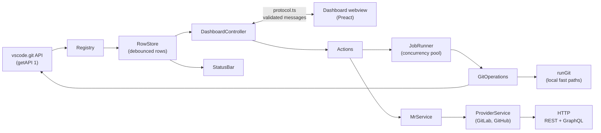

# Developer guide

> **Applies to:** everyone who builds, runs, tests or changes RepoHangar
> **Requires:** Node.js 20 or later, npm, Git, VS Code 1.93 or later; Docker only for the nightly GitLab job
> **Related:** [openspec.md](openspec.md) (how a change is planned), [spec-writing.md](spec-writing.md),
> [versioning.md](versioning.md)

This guide covers the code: how to set up a checkout, run the extension from source, find your way around the
modules, and run the four test layers. What RepoHangar should do is in `openspec/specs/`, and every change to that
behaviour goes through the OpenSpec workflow in [openspec.md](openspec.md) before any code is written.

## 1. Setup

```sh
git clone <repo-url> repo-hangar
cd repo-hangar
npm ci
npm run build
```

`npm run build` writes `dist/`: the extension host bundle (`extension.js`), the two webview bundles (`webview.js` for
the dashboard, `profiles.js` for the MR profile editor) with their CSS, and a copy of the codicons. `dist/` and `out/`
are build output and are not committed.

On Windows, use Git Bash or PowerShell; every npm script works in both. The integration tests set
`core.autocrlf false` in the repositories they create, so a global `core.autocrlf true` (the Git for Windows default)
does not affect them.

## 2. Scripts

| Script | What it does |
|---|---|
| `npm run build` | Development build of `dist/` with source maps ([`esbuild.mjs`](../esbuild.mjs)) |
| `npm run watch` | The same build, rebuilt on every save |
| `npm run typecheck` | `tsc --noEmit` over `src`, `webview`, `test` and the configs. esbuild does not type-check, so run this before committing |
| `npm test` | Vitest: the `unit` and `contract` projects (§6.1, §6.2) |
| `npm run test:integration` | Builds the tests and runs the `@vscode/test-electron` sessions (§6.3) |
| `npm run test:ui` | Builds and runs the Playwright tests against a real VS Code window (§6.4) |
| `npm run test:nightly` | The GitLab CE 17.10.0 compatibility tests; not part of `npm test` (§6.5) |
| `npm run package` | Production build and `vsce package` into `repohangar-<version>.vsix` (§4) |

## 3. Running from source

There is no committed launch configuration. Start the build in watch mode and open a second VS Code window with this
folder as the extension under development:

```sh
npm run watch
code --extensionDevelopmentPath="$PWD" /path/to/a/folder/with/repos
```

The development copy takes precedence over an installed `enbinario.repohangar`. After a rebuild, run **Developer:
Reload Window** in the development window. To debug the extension host, add `--inspect-extensions=9229` and attach
VS Code's Node debugger to port 9229.

Things to know when trying it out:

- **Workspace Trust.** RepoHangar does not run in Restricted Mode, because the built-in Git extension it depends on
  is disabled there. Trust the folder you open.
- **Logs.** Failures that do not deserve a notification go to the **RepoHangar** output channel (a log channel; set
  its level to Trace to see provider request timings). Tokens, headers and request bodies are never logged.
- **The webview.** Run **Developer: Open Webview Developer Tools** while the dashboard or the profile editor is focused
  to inspect its DOM and console.
- **Git Graph Opener.** If the old `enbinario.git-graph-opener` extension is installed, RepoHangar's duplicate-menu
  guard hides its own Explorer entries and offers once to uninstall it. Uninstall Git Graph Opener to see
  RepoHangar's menus.

## 4. Installing a local build

```sh
npm run package
code --install-extension repohangar-0.0.0.vsix --force
```

`vsce package` runs `vscode:prepublish`, which builds `dist/` with `--production` (minified, no source maps).
[`.vscodeignore`](../.vscodeignore) ships only `dist/`, `package.json`, `README.md`, `CHANGELOG.md` and `LICENSE`, so
the VSIX is about 160 KB. Reload open windows to pick up the new version, and remove it with
`code --uninstall-extension enbinario.repohangar`.

The version stays `0.0.0` until the first release. Never edit it by hand; only the release script changes it
([versioning.md §5](versioning.md#5-releasing)).

## 5. Architecture

RepoHangar is one extension host bundle plus two webviews. The extension host owns every piece of logic; the webviews
render what it sends and post back what the user did.



### 5.1 Where the code lives

| Folder | What it holds |
|---|---|
| [`src/extension.ts`](../src/extension.ts) | Activation: runs the Git Graph Opener settings migration, then wires the Git API, registry, store, runner, dashboard, status bar, providers, MR service and commands. Returns a `TestApi` the integration tests use |
| [`src/git/`](../src/git/) | Access to the built-in Git API, the repository registry, remote URL parsing, repository-root scanning, ff-only eligibility, guards, branch batches and `runGit` (the only place a `git` process starts) |
| [`src/jobs/`](../src/jobs/) | `JobRunner` (the concurrency pool, timeouts, cancellation), per-repo results and the batch summary |
| [`src/state/`](../src/state/) | `RowStore`: per-repository row snapshots, debounced and coalesced into patches |
| [`src/providers/`](../src/providers/) | Provider detection, the GitLab and GitHub clients, the version probe, authentication (`vscode.authentication`, GitLab tokens in `SecretStorage`), the batched review-status queue and the HTTP layer |
| [`src/mr/`](../src/mr/) | MR profiles and rules, templates, guards, push options, multi-repo MRs, recent reviewers, Save as defaults and the profile editor panel |
| [`src/integrations/`](../src/integrations/) | Git Graph detection and opening, Explorer reveal, Source Control reveal and selection sync, the settings migration, and thin wrappers over VS Code commands and notifications |
| [`src/ui/`](../src/ui/) | The dashboard panel, actions, quick inputs, the status bar and per-workspace view state |
| [`src/shared/`](../src/shared/) | Types and pure functions shared by the host and the webviews: the row model, cell formatting, the message protocol and its validator, the drawer, batch results, row menus |
| [`webview/`](../webview/) | Preact components: `main.tsx` and `App.tsx` (dashboard), `profiles.tsx` and `ProfileEditor.tsx` (profile editor), `Drawer.tsx`, `BatchResult.tsx`, `RowActions.tsx` |

### 5.2 Rules the code keeps

These come from the project context in [`openspec/config.yaml`](../openspec/config.yaml) and are checked in review.

- **Logic modules import nothing from `vscode`.** URL parsing, provider detection, profile resolution, templates,
  repository-root scanning, ff-only eligibility, the store, the runner and the HTTP layer take their dependencies as
  small interfaces (ports) instead, for example `FileSystemPort` in [`src/git/fsPort.ts`](../src/git/fsPort.ts).
  Each such file says `No vscode import.` in its header comment. This is what lets Vitest test them without VS Code.
- **The webview is a pure view.** It holds no logic beyond rendering and input. Every message it posts is checked by
  `parseViewMessage` in [`src/shared/protocol.ts`](../src/shared/protocol.ts) before the host acts on it; add new
  messages there, with a case in [`test/unit/protocol.test.ts`](../test/unit/protocol.test.ts).
- **Git state comes from the built-in Git API.** Network operations (fetch, pull, push) go through it so VS Code's
  credential prompts keep working. RepoHangar's own `git` processes are for local fast paths only, through `runGit`
  in [`src/git/process.ts`](../src/git/process.ts): `execFile` with an argument array, no shell, a 10 s timeout and
  `GIT_TERMINAL_PROMPT=0`.
- **Providers through HTTP.** GitLab and GitHub are reached through their REST and GraphQL APIs, with one batched
  status query per host. `glab` and `gh` are only optional token sources.
- **Tokens stay secret.** GitHub uses `vscode.authentication`; GitLab tokens live only in `SecretStorage`, keyed by
  host. A token never appears in settings, logs or the webview, and is sent only to its own host.
- **No telemetry. No merging.** RepoHangar never merges a merge request, and destructive actions always confirm and
  are never a batch default.
- **Naming.** Settings, commands and context keys use the `repohangar.` prefix. Comments cite the spec or design
  decision they implement (`design D-4`, `hosting-providers: Probe matrix R3`) so a reader can find the requirement.

## 6. Tests

Each layer has its own folder and its own job. A decision-table task in `tasks.md` names the layer its test lives in,
with one case per row id ([spec-writing.md §10](spec-writing.md#10-tables--tasks--tests)).

| Layer | Folder | Runs with | Use it for |
|---|---|---|---|
| Unit | [`test/unit/`](../test/unit/) | `npm test` | Pure logic and webview components |
| Contract | [`test/contract/`](../test/contract/) | `npm test` | Provider requests and responses against recorded fixtures |
| Integration | [`test/integration/`](../test/integration/) | `npm run test:integration` | The extension in a real VS Code with real Git repositories |
| UI | [`test/ui/`](../test/ui/) | `npm run test:ui` | What the user sees and presses in the webview |
| Nightly | [`test/nightly/`](../test/nightly/) | `npm run test:nightly` | The GitLab provider against a real GitLab CE 17.10.0 |

### 6.1 Unit

Vitest, Node environment. Webview component tests opt into jsdom with a `// @vitest-environment jsdom` comment at the
top of the file (see [`test/unit/webview/`](../test/unit/webview/)). Decision tables become `it.each` with the row id
in the test name. Helpers such as [`memFs.ts`](../test/unit/memFs.ts) and [`rows.ts`](../test/unit/rows.ts) build
in-memory file systems and rows.

```sh
npx vitest run --project unit test/unit/rules.test.ts
npx vitest --project unit            # watch mode
```

### 6.2 Contract

An [msw](https://mswjs.io/) server answers provider requests with recorded JSON from
`test/contract/fixtures/<host>/<operation>.json` (`git.acme.com` for GitLab, `github.com` for GitHub) and records
every request, so a test can assert the exact method, URL, headers and body. Start from
[`helpers.ts`](../test/contract/helpers.ts) (`contractServer`, `fixture`) and
[`flowHarness.ts`](../test/contract/flowHarness.ts). When a provider's response shape changes, record a new fixture
rather than editing an old one by hand.

### 6.3 Integration

[`runTest.ts`](../test/integration/runTest.ts) downloads VS Code (stable, or `VSCODE_VERSION`), builds fixture
workspaces of real repositories cloned from bare remotes in a temp folder, and runs one VS Code session per fixture
with a fresh user data and extensions folder:

| Session | Fixture |
|---|---|
| `main` | The main workspace of 14 repositories |
| `gitDisabled` | Two repositories with `git.enabled: false` |
| `perf` | 50 repositories, half on a GitLab host and half on github.com |
| `providers` | Repositories on GitLab, GitHub, an unknown host and none |
| `gitGraph` | Starts without Git Graph; the tests install Git Graph 1.30.0 and Git Graph Opener from VSIX files |
| `migration` | Old `gitGraphOpener.*` settings at user, workspace and folder scope |

A session runs the test files in `test/integration/suite/<session>/`, in numeric order (`120-…` after `95-…`). No
session reaches GitLab or GitHub: requests go to a local stub unless the test answers them. Tests get the extension's
`TestApi` from activation, and `tempRepos.ts` creates throwaway repositories for one suite.

```sh
npm run test:integration -- --session=main
```

The first run needs network access to download VS Code and the Git Graph VSIX into `.vscode-test/`.

### 6.4 UI

Playwright drives a real VS Code (Electron) window through [`test/ui/vscode.ts`](../test/ui/vscode.ts). By default
the extension runs from this folder; `launch(fixture, { installed: true })` packages and installs the VSIX instead,
which is how the Workspace Trust tests see what a user gets. Tests run one at a time with a 3-minute timeout, and
failures leave traces in `test-results/`.

```sh
npm run test:ui -- test/ui/grid.spec.ts
```

### 6.5 Nightly GitLab

[`test/nightly/setup.ts`](../test/nightly/setup.ts) starts `gitlab/gitlab-ce:17.10.0-ce.0` in Docker on port 8929
(the boot takes up to 15 minutes), creates a root API token, seeds a project with a merge request, runs the tests and
removes the container. To reuse an instance you already run, set `REPOHANGAR_GITLAB_URL` and
`REPOHANGAR_GITLAB_TOKEN` and nothing is started. The
[nightly workflow](../.github/workflows/nightly-gitlab.yml) runs it every night at 03:00 UTC and on demand.

## 7. Making a change

1. **Plan it.** For a change in behaviour, propose an OpenSpec change and have it reviewed before writing code
   ([openspec.md §4](openspec.md#4-the-change-lifecycle)). Documentation, tests and internal refactoring with no
   user-observable effect skip this.
2. **Branch.** Work on a branch, never on `main`.
3. **Implement with tests.** Work through `tasks.md` in order and tick a task only when its tests pass. If the code
   shows that a spec is wrong, fix the delta first.
4. **Check.** Run `npm run typecheck` and `npm test`, plus the integration or UI session that covers what you changed.
5. **Changelog.** Add a kind-prefixed entry under `## Unreleased` in [`CHANGELOG.md`](../CHANGELOG.md) for any
   user-observable change ([versioning.md §2](versioning.md#2-classifying-a-change)). Do not bump the version.
6. **Commit.** Use [Conventional Commits](https://www.conventionalcommits.org/) (`feat:`, `fix:`, `docs:`, `test:`,
   …), name the OpenSpec change in parentheses at the end of the subject when there is one, and end every commit with a
   `Co-Authored-By` trailer.
7. **Archive.** Archive the OpenSpec change in the same pull request, so `openspec/specs/` describes `main`.

A new setting is declared in `contributes.configuration` in `package.json` with its type, default and description,
and documented in the README's Settings section. A new command gets a `repohangar.` id and, if users can reach it
from the Command Palette, a title in the `RepoHangar` category.

The documentation site, `https://repohangar.enbinario.com`, lives in [`site/`](../site/README.md) (Docusaurus). Its
settings, commands and changelog pages are generated from `package.json` and `CHANGELOG.md` on every build, so they
need no edit. Its guide pages (`site/docs/`) are written by hand: when a change alters what a page describes, update
the page in the same pull request. The site deploys when a `v*` tag is pushed.

## Decision log

- 2026-10-11: Guide written from the state of the repository after `add-profile-editor`. Running from source is
  documented as a `code --extensionDevelopmentPath` command rather than a committed `.vscode/launch.json`.
