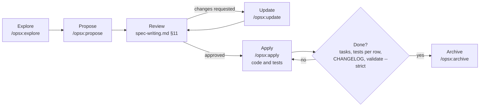

# OpenSpec workflow

> **Applies to:** every change to RepoHangar's behaviour, from proposal to archive
> **Set up with:** OpenSpec CLI 1.13.0, `openspec init --tools claude` (`openspec/`, `.claude/skills/openspec-*`,
> `.claude/commands/opsx/`)
> **Project rules:** [`openspec/config.yaml`](../openspec/config.yaml), with the full standards in
> [spec-writing.md](spec-writing.md) and [versioning.md](versioning.md)

[OpenSpec](https://github.com/Fission-AI/OpenSpec) records what RepoHangar should do. Each capability has a spec in
`openspec/specs/<capability>/spec.md`, and each change to behaviour is a folder in `openspec/changes/<change>/` with a
proposal, a design, tasks and **delta specs** that say which requirements it adds, modifies, removes or renames.
Archiving a change merges its deltas into the capability specs. The product source of truth for the first changes is
`PROPOSAL.md` (r6), which is kept outside this repository; changes cite it by section and decision id.



## 1. What is installed

| Path | What it is |
|---|---|
| `openspec/config.yaml` | Schema `spec-driven`, the project context, the per-artifact `rules` and the per-operation `guidance` (§2) |
| `openspec/specs/` | One folder per capability, written only by archiving a change (§3) |
| `openspec/changes/` | Active changes; `archive/` keeps archived ones as `<date>-<change>` |
| `.claude/skills/openspec-*` | The OpenSpec skills for Claude Code: `propose`, `explore`, `apply-change`, `update-change`, `sync-specs`, `archive-change` |
| `.claude/commands/opsx/` | The matching slash commands: `/opsx:propose`, `/opsx:explore`, `/opsx:apply`, `/opsx:update`, `/opsx:sync`, `/opsx:archive` |
| `.claude/skills/spec-writing`, `.claude/skills/changelog-entry` | RepoHangar's own skills: write or review a delta against [spec-writing.md](spec-writing.md), and add a CHANGELOG entry per [versioning.md](versioning.md) |
| `.claude/rules/` | Path-scoped rules that load the standards when an agent edits `openspec/**` or `CHANGELOG.md` |

After upgrading the OpenSpec CLI, run `openspec update` so the skills and commands match the new version, review the
diff and commit it. To add another agent, run `openspec init --tools <tool>` again (for example `cursor` or
`github-copilot`); the rules in `config.yaml` apply to every tool because the CLI injects them into its instructions.

OpenSpec offers more workflows (`new`, `continue`, `ff`, `bulk-archive`, `verify`, `onboard`) through
`openspec config profile`. They are not installed; the six above cover this workflow.

## 2. Project rules

`openspec/config.yaml` is what every agent reads when it creates or applies a change:

- **`context`** summarizes the product, the decisions that constrain every change (Git state only from the built-in
  Git API, providers through HTTP APIs, tokens only in `SecretStorage`, no merging from the dashboard), the tech stack,
  the architecture rules and the conventions. Update it in the same commit when a decision in the proposal changes.
- **`rules.proposal`**, **`rules.specs`** and **`rules.tasks`** are the short form of [spec-writing.md](spec-writing.md)
  and [versioning.md](versioning.md). When a standard changes, change its rule line in the same commit.
- **`operations.apply`** and **`operations.archive`** are advisory guidance that `openspec instructions apply` and
  `openspec instructions archive` print: tick a task only after its tests pass, never bump the version by hand, and
  validate before and after archiving.

## 3. Capabilities

A capability is one area of behaviour that a user can name. Its spec lists requirements, never modules. The names
below follow the proposal's sections and roadmap phases (§13); they are planned, and the change that creates a
capability fixes its name and its `## Purpose`.

| Capability | Behaviour | Proposal | Phase |
|---|---|---|---|
| `repo-registry` | Which repositories appear, their remotes (`{host, provider, projectPath}`) and groups | §4.2, §5.1, §6.2 | 1 |
| `dashboard` | The grid: columns, cell text, special states, filters, groups, keyboard map, row details, reload, and the read-only local state in its cells (last fetch, stash count, operation in progress) | §8, §10.2, §5.3, W2–W3 | 1 |
| `status-bar` | The status bar summary and its tooltip | §8.1, W1 | 1 |
| `git-operations` | Row actions on one repository and the local fast paths for them (default branch, ff-only) | §5.2, §5.3 | 1 |
| `batch-operations` | Fetch all, Pull all (ff), switch or create a branch across repositories, per-repo results and the summary | §5.3, §11.1 | 1 |
| `explorer-open-in-git-graph` | Open in Git Graph, or Open in Source Control Graph without it, from every entry point | §9.2, §9.4, D14 | 1 |
| `explorer-reveal` | Reveal in Explorer, and repositories outside the workspace folders | §9.3, D16 | 1 |
| `source-control-reveal` | Showing Source Control and returning focus | §9.5 | 1 |
| `source-control-selection-sync` | Selecting the repository in Source Control (single selection mode) | §9.5, D17 | 1 |
| `git-graph-opener-migration` | Settings migration and the duplicate-menu guard | Appendix D, D15 | 1 |
| `hosting-providers` | Provider detection, batched review status, the REST fallback, refresh triggers | §6.1–§6.5, §11.1 | 2 |
| `provider-auth` | GitHub sessions, GitLab tokens, `glab`/`gh` import, sign out | §6.3, §12 | 2 |
| `mr-profiles` | Profiles, rules, resolution order, policy check, templates, saving defaults, the profile editor | §7.1–§7.4, D6 | 2–3 |
| `mr-creation` | Create with defaults, the drawer and quick input, guards, reviewers and assignees, squash and delete-branch mapping, auto-merge, Undo, push options, multi-repo MRs | §7.5–§7.8, §6.6, D7, D8, D19 | 2–3 |
| `scan-roots` | Repositories outside the workspace and light mode | §5.4 | 4 |

`explorer-open-in-git-graph`, `source-control-reveal` and `source-control-selection-sync` keep the names of Git Graph
Opener's capabilities (Appendix D), with the `gitGraphOpener.*` settings renamed and the Git Graph requirement made
conditional. Cross-cutting rules (Workspace Trust, destructive actions, token handling) are requirements of the
capability whose action they constrain, not a capability of their own.

## 4. The change lifecycle

### 4.1 Explore (optional)

`/opsx:explore` is a thinking partner: it reads the specs and the code, and writes nothing until you confirm. Use it
when the scope or the capability is unclear.

### 4.2 Propose

```text
/opsx:propose add-batch-operations
```

The skill runs `openspec new change`, then writes `proposal.md`, the delta specs under `specs/<capability>/spec.md`,
`design.md` and `tasks.md`, following `config.yaml`. It plans only and changes no code.

- **Name** the change in kebab case, starting with a verb: `add-…`, `change-…`, `remove-…`, `import-…`. One change per
  slice of a roadmap phase that can be reviewed and shipped on its own.
- **The proposal** cites the PROPOSAL.md sections, wireframes and decision ids it implements and its roadmap phase,
  and states `Depends on: <change>` when it builds on a change that is not archived yet (§5).
- **The deltas** follow [spec-writing.md](spec-writing.md): decision tables for every outcome with two or more
  conditions, checkable outcomes, settings by key and default.
- **The tasks** give every decision table a task that names its test, one case per row id, and end with the CHANGELOG
  entry when the change has a user-observable effect.

### 4.3 Review

A person reviews the change before any code is written: the deltas against the checklist in
[spec-writing.md §11](spec-writing.md#11-review-checklist), and the planned CHANGELOG kind against
[versioning.md §2](versioning.md#2-classifying-a-change). The `spec-writing` skill runs the same checklist for an
agent. To revise the plan, use `/opsx:update`, which keeps the proposal, deltas, design and tasks consistent and never
edits code.

```sh
openspec validate add-batch-operations --strict
openspec show add-batch-operations
```

### 4.4 Apply

```text
/opsx:apply add-batch-operations
```

The skill works through `tasks.md` in order. A task is ticked only when its tests pass; a table task is done when its
test has one case per row id ([spec-writing.md §10](spec-writing.md#10-tables--tasks--tests)). If the code shows that
a spec is wrong, stop, fix the delta with `/opsx:update`, and continue: the spec and the code never disagree at
archive time.

### 4.5 Done

A change is ready to archive when all of these hold:

| Check | How |
|---|---|
| Every task is ticked | `openspec status --change <change>` |
| Every decision table row has a test case | The table tasks in `tasks.md` name the tests; the tests pass |
| The deltas validate | `openspec validate <change> --strict` |
| The CHANGELOG has the entry | A kind-prefixed entry under `## Unreleased` ([versioning.md §3](versioning.md#3-writing-an-entry)), or the change is R14 (no user-observable effect) |
| No version bump | `version` in `package.json` is unchanged |

### 4.6 Archive

```text
/opsx:archive add-batch-operations
```

The skill checks the change, merges its deltas into `openspec/specs/` and moves the folder to
`openspec/changes/archive/<date>-add-batch-operations/`. The CLI equivalent is `openspec archive add-batch-operations
--yes`. Afterwards, `openspec validate --specs --strict` checks that the synced specs still validate together.

Archive in the same pull request as the implementation, so `openspec/specs/` always describes the code on `main`.
`/opsx:sync` merges deltas into the specs without archiving. This workflow does not use it: archiving does the same
merge at the end, and §5 covers changes that build on each other.

## 5. Changes that build on each other

The first changes of a phase usually add to the same capabilities. OpenSpec cannot apply `MODIFIED` to a requirement
that is not in `openspec/specs/` yet, so:

- a change that adds to a capability created by an unarchived change uses `ADDED` only and states
  `Depends on: <change>` in its proposal;
- changes are archived in dependency order;
- once a capability is archived, later changes use `MODIFIED`, `REMOVED` and `RENAMED` within the limits of
  [spec-writing.md §9](spec-writing.md#9-names-citation-and-deltas).

## 6. In CI (planned)

The pull request workflow runs `openspec validate --all --strict`, so a change with an invalid delta or a spec broken
by an archive cannot be merged, and `openspec validate --archived` checks that every archived change has all its tasks
ticked. Until the workflow exists, run both before opening a pull request.

## Decision log

- 2026-10-08: OpenSpec set up with `openspec init --tools claude` (CLI 1.13.0, schema `spec-driven`, the core profile
  of six workflows). Project rules adapted from ReqAnchor's `openspec/config.yaml`, without its ReqAnchor anchor step:
  RepoHangar does not link requirements to code. Capability names follow the proposal's sections and keep Git Graph
  Opener's names for the behaviour it brings over.
