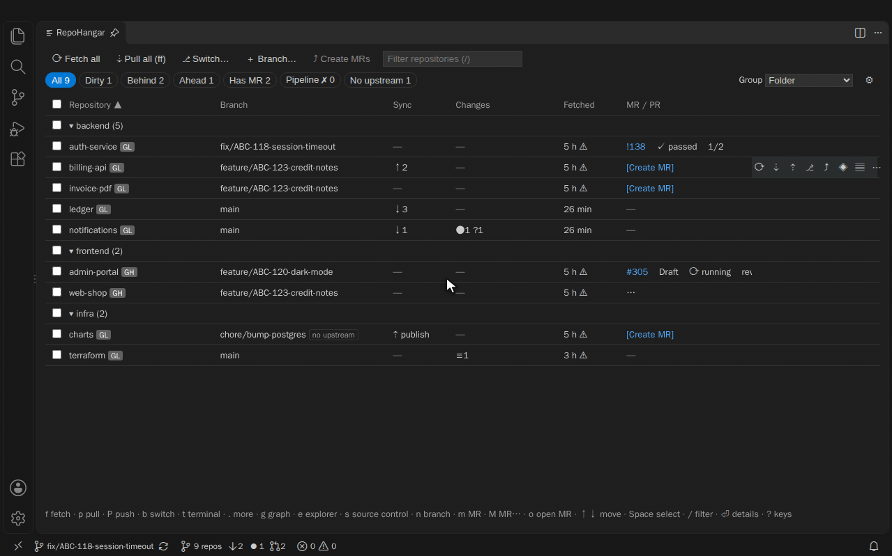

import Tabs from '@theme/Tabs';
import TabItem from '@theme/TabItem';

# Getting started

## Install

RepoHangar's extension ID is `enbinario.repohangar`. Until the first release reaches the VS Code Marketplace, install
it from a VSIX file.

<Tabs groupId="install">
<TabItem value="vsix" label="VSIX" default>

1. Download `repohangar-<version>.vsix` from the
   [GitHub releases](https://github.com/en-binario/repohangar/releases).
2. In VS Code, open the **Extensions** view, click `⋯` at the top and choose **Install from VSIX…**, or run:

   ```bash
   code --install-extension repohangar-<version>.vsix
   ```

</TabItem>
<TabItem value="marketplace" label="VS Code Marketplace">

Once it's published, search for **RepoHangar** in the Extensions view, or run:

```bash
code --install-extension enbinario.repohangar
```

</TabItem>
<TabItem value="openvsx" label="Open VSX">

For VSCodium and other editors that use [Open VSX](https://open-vsx.org): once it's published, search for
**RepoHangar** in the Extensions view.

</TabItem>
</Tabs>

## Open the dashboard

Open a folder or a `.code-workspace` that contains Git repositories, and trust it when VS Code asks. Then:

- press `Ctrl+Alt+H` (`Ctrl+Cmd+H` on macOS), or
- run **RepoHangar: Open Dashboard** from the Command Palette, or
- click the RepoHangar summary in the status bar (`⎇ 14 repos ↓3 ●2`), or
- click **Open RepoHangar** in the Source Control title bar.

The dashboard lists every repository that VS Code's Git extension opened, grouped by the folder that contains them.
To open it whenever a workspace has 3 or more repositories, set
[`repohangar.openOnStartup`](reference/settings.md#repohangar-openonstartup) to `"multiRepo"`.

## Connect your hosts

The first time the dashboard opens, a panel lists the GitLab and GitHub hosts of your repositories and how each one
is connected:

| Host | What RepoHangar uses |
|---|---|
| github.com | Your VS Code GitHub account. Click **Sign in** if you aren't signed in |
| GitHub Enterprise | The VS Code account of `github-enterprise.uri`, a stored token, or your `gh` login |
| GitLab | A stored token, else your `glab` login. **Sign in** opens the token page with the name `RepoHangar` and the `api` scope filled in, then asks you to paste the token |

Choose **Skip — git only** for a host you don't want RepoHangar to contact. You can change your mind later with
**RepoHangar: Sign In to Host…** and **RepoHangar: Sign Out of Host…**. See
[Status and signing in](merge-requests/status-and-sign-in.md).

## Set up a default MR profile

The same panel offers **Set up a default profile**: the target branch, title pattern, reviewers, labels, squash and
the other values every new merge request starts with. You can also open the editor later with the `⚙` button in the
dashboard toolbar or **RepoHangar: Edit MR Profiles**. See [MR profiles](merge-requests/profiles.md).

## Create your first merge request

Move to a repository on a feature branch (`↑` `↓`, or `/` to filter) and press `m`. The **Create MR drawer** opens
with every field filled in from the profile; check them and press `Ctrl+Enter`. RepoHangar pushes the branch if it
needs to, creates the merge request (or pull request on GitHub) and shows its number in the **MR / PR** column.



## Next steps

- Learn the [dashboard keys](guide/dashboard.md#keys): press `?` in the dashboard for the same list.
- [Fetch and pull](guide/batch-operations.md) every repository at once.
- [Switch or create a branch](guide/branches.md) in several repositories.
- Create [linked merge requests](merge-requests/several-repositories.md) for a feature that spans repositories.
