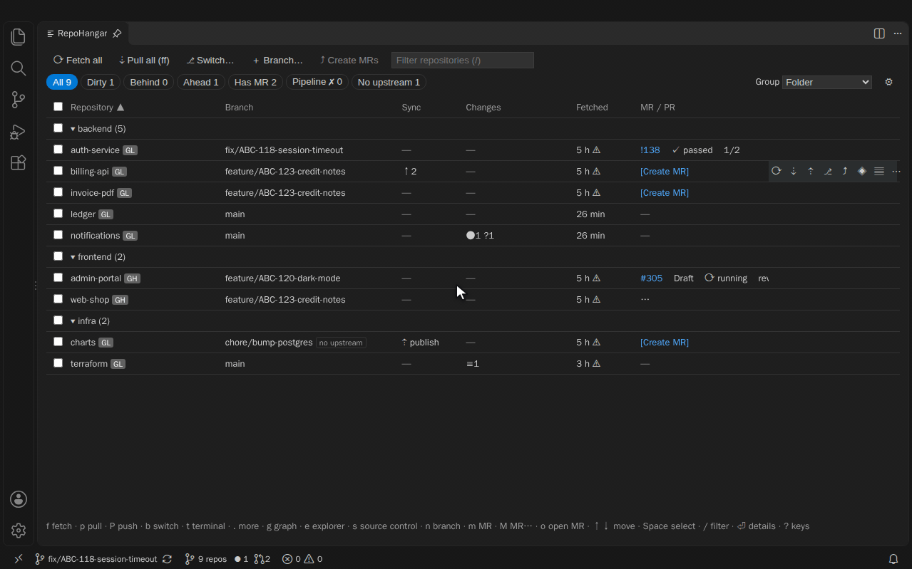

# Fetch and pull



## Fetch all

**RepoHangar: Fetch All** (`F` in the dashboard, or **⟳ Fetch all** in its toolbar) fetches every repository, or only
the selected rows (the button then reads **⟳ Fetch (3)**). `f` fetches the focused row, or the selected rows.

Fetch all and Pull all (ff) fetch [`repohangar.concurrency`](../reference/settings.md#repohangar-concurrency)
repositories at the same time (6 by default). A fetch that takes longer than
[`repohangar.fetchTimeoutSeconds`](../reference/settings.md#repohangar-fetchtimeoutseconds) (60 s) is recorded as
failed.

## Pull all (fast-forward only)

**RepoHangar: Pull All (Fast-Forward Only)** (**⇣ Pull all (ff)** in the toolbar, or `p` with rows selected) only
fast-forwards a clean branch that is behind and not ahead. Every other repository is skipped with its reason:
`dirty (3 files)`, `diverged (↑1 ↓1)`, `detached HEAD`, and so on. Nothing is forced, stashed, merged or rebased.

**RepoHangar: Fetch Repository** and **RepoHangar: Pull (Fast-Forward Only)** act on one repository: the one of the
active editor, the one selected in Source Control, or one you pick.

## Progress and summary

Each batch shows a progress notification with **Cancel**, then a summary such as:

```text
Pull all (ff) — finished in 6.2 s: ✓ 9 updated · ↷ 4 skipped · ✗ 1 failed
```

## Batch results

When Fetch all, Pull all (ff), [Switch or Create branch](branches.md) ends with a skipped or failed repository, a panel
above the grid lists every repository with its result, failures first, and a button that fixes it:

| Batch | Result | Buttons | What the first button does |
|---|---|---|---|
| Pull (ff) | `skipped: dirty (3 files)` | **Stash and pull** | Stashes with the message `RepoHangar: before pulling` (untracked files included), then pulls (ff) |
| Pull (ff) | `skipped: diverged (↑1 ↓1)` | **Pull with rebase**, **Open SCM** | VS Code's *Pull (Rebase)* on that repository |
| Pull (ff) | `skipped: no upstream` | **Publish** | Publishes the branch |
| Pull (ff), Switch or Create | `skipped: rebase in progress` (or another operation) | **Open SCM** | Shows the repository in Source Control |
| Fetch or Pull (ff) | `failed: <message>` | **Show Git Output** | Opens the Git output |
| Switch | `skipped: dirty (3 files)` | **Stash and switch** | Stashes, then switches |
| Switch | `skipped: no branch feature/ABC-12-notes` | **Create branch here** | Creates and checks out the branch in that repository |

Each button acts on that repository only and updates its line with the new result.

**Retry failed** runs the same batch again on the failed repositories only. A batch started from the Command Palette
offers the panel with **Show Details** in its summary notification.
