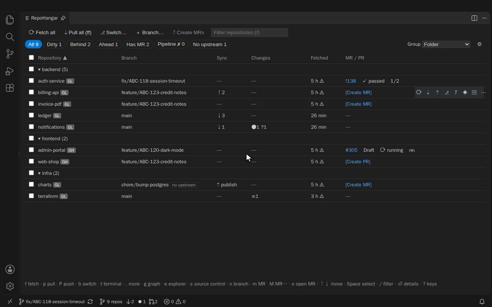

# Branches across repositories



A feature often touches several repositories. RepoHangar switches or creates its branch in all of them at once.
Without a selection, the commands and toolbar buttons act on every repository; `n` acts on the focused row.

## Switch branch

Select the repositories of a feature and press `b`, click **⎇ Switch…** in the toolbar, or run **RepoHangar: Switch
Branch in Repositories…**. One quick pick lists the branches those repositories have, the most common first, with
where each one is:

```text
feature/ABC-123-add-billing-notes    local in 2 · remote in 1 (tracking branch will be created)
```

A branch that only exists on the remote becomes a tracking branch; a repository without the branch is skipped. The
list comes from local refs, so run [Fetch all](batch-operations.md) first to see branches that only exist on the
server.

### Uncommitted changes

When some repositories have uncommitted changes, RepoHangar asks once:

| Choice | What happens |
|---|---|
| **Skip** (default) | Those repositories stay on their branch |
| **Stash and switch** | `git stash push --include-untracked` with the message `RepoHangar: before switching to <branch>`, then the switch. The stash is kept for you to pop |
| **Switch anyway** | Switches where Git can; Git refuses a checkout that would overwrite your changes |

`Esc` cancels everything.

## Create a branch

To start a feature, press `n`, click **＋ Branch…** or run **RepoHangar: Create Branch in Repositories…**, and type
the name once. It's checked with `git check-ref-format --branch`, then created and checked out from the current HEAD
of each repository.

Typing a new name in the switch quick pick offers `＋ Create "<name>" from current HEAD in all <n>` as well.

Skipped or failed repositories appear in the [batch results panel](batch-operations.md#batch-results), with
**Stash and switch** or **Create branch here** to fix them.
