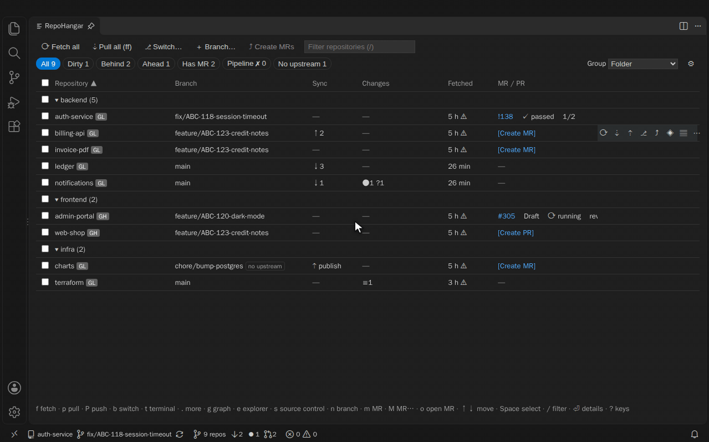

# The dashboard

The dashboard has one row per repository that VS Code's built-in Git extension opened. Open it with
`Ctrl+Alt+H` (`Ctrl+Cmd+H` on macOS), **RepoHangar: Open Dashboard**, the status bar summary, or **Open RepoHangar**
in the Source Control title bar. It's restored after a window reload.



## Columns

| Column | Shows |
|---|---|
| Repository | Name and host (`GL` GitLab, `GH` GitHub, `?` unknown); the tooltip has the path and the remote URL |
| Branch | Branch name and a `no upstream` badge, or `detached a1b2c3d`, `REBASING 3/7`, `MERGING`, `CHERRY-PICKING`, `REVERTING` |
| Sync | `↑ahead ↓behind`, `⇡ publish` for unpublished branches, `—` when there is nothing to sync |
| Changes | `⚠ n confl`, `●` unstaged, `+` staged, `?` untracked, `≡` stashes |
| Fetched | Time since the last fetch, `⚠` when older than [`repohangar.staleFetchHours`](../reference/settings.md#repohangar-stalefetchhours) |
| MR / PR | The open merge request (`!142`) or pull request (`#311`) of the branch, `Draft`, the pipeline or checks (`✓ passed`, `⟳ running`, `◷ pending`, `✗ failed`), approvals (`1/2` on GitLab, `changes requested` on GitHub) and `auto ⇢`; `Sign in` when the host has no credential, `?` for an unknown host |

Rows update as soon as the Git extension sees a change; RepoHangar never polls Git. The **MR / PR** column is
refreshed as described in [Status and signing in](../merge-requests/status-and-sign-in.md).

## Groups

Repositories are grouped by the folder that contains them. Change it with
[`repohangar.groupBy`](../reference/settings.md#repohangar-groupby): `workspaceFolder`, `none`, or `custom` with
named globs in [`repohangar.groups`](../reference/settings.md#repohangar-groups):

```json5
"repohangar.groupBy": "custom",
"repohangar.groups": {
  "Payments": ["**/payments/**"],
  "Web": ["**/web-*"]
}
```

The first matching group wins; repositories that match none go to `Other`. `Enter` on a group header collapses it.

## Filter and chips

Press `/` to filter by repository name, branch or group. The chips above the grid narrow the list further: **All**,
**Dirty**, **Behind**, **Ahead**, **Has MR**, **Pipeline ✗** and **No upstream** (keys `1` to `7`). `Esc` clears the
filter, then the selection.

## Sort

Click a column header to sort the rows within each group:

1. The first click puts what needs attention on top: most behind, most changes, oldest fetch, failed pipeline (A→Z
   for names).
2. A second click reverses it.
3. A third click goes back to repository name A→Z.

The sort is remembered for the workspace. From the keyboard, press `S` to focus the column headers, then `←` `→` and
`Enter`; `↓` or `Esc` returns to the rows.

## Select

The checkbox on a group header selects every repository of the group that the filter shows (`−` when only some are
selected), and the checkbox above the rows does the same for every repository the filter shows. Shift+click a row's
checkbox to select every row from the last one you clicked. `Space` toggles the focused row or group, and `Ctrl+A`
selects all shown rows.

Toolbar buttons and keys such as `F`, `b`, `n` and `m` act on the selected rows when there are any.

## Keys

Press `?` in the dashboard to show this list.

| Key | Action |
|---|---|
| `↑` `↓` / `j` `k` | Move |
| `Space` | Toggle selection of the focused row, or of every row of the focused group |
| `Ctrl+A` | Select all shown rows |
| `/` | Filter by name, branch or group |
| `S` | Sort: focus the column headers, then `←` `→` and `Enter`; `↓` or `Esc` returns to the rows |
| `Enter` | Row details, or collapse a group |
| `1` – `7` | Chips All, Dirty, Behind, Ahead, Has MR, Pipeline ✗, No upstream |
| `Esc` | Clear the filter, then the selection |
| `?` | Key help |
| `f` | Fetch the focused row, or the selected rows |
| `F` | Fetch all (or the selected rows) |
| `p` | Pull the focused row, or pull (fast-forward only) the selected rows |
| `P` | Push the focused row, or publish a branch without upstream |
| `b` | Switch branch in the focused row with VS Code's branch picker, or in the selected rows |
| `n` | Create a branch in the focused row, or in the selected rows |
| `t` | Open a terminal in the focused row's repository |
| `g` | Open the focused row in Git Graph (or the Source Control Graph) |
| `e` | Reveal the focused row in the Explorer |
| `s` | Show the focused row in Source Control |
| `m` | Create the merge request or pull request of the focused row with its profile's defaults, or one per selected row, linked to each other |
| `M` | Open the Create MR drawer for the focused row |
| `o` | Open the merge request or pull request of the focused row |
| `.` | Open the focused row's menu |

## Clicks

| Where | What it does |
|---|---|
| Repository name | Opens it in Git Graph when Git Graph is installed, else reveals it in the Explorer ([`repohangar.dashboard.nameClick`](../reference/settings.md#repohangar-dashboard-nameclick)) |
| Branch cell | Switch branch |
| Sync cell | Pull, push, publish or sync, depending on what it shows |
| Changes cell | Show the repository in Source Control |
| Fetched cell | Fetch |
| `!142` / `#311` | Open the merge request or pull request in the browser |

Push and pull refuse a detached HEAD, a rebase or merge in progress, or a push that is behind the remote branch, and
say why (with **Pull** when you're behind). While an action runs, the Sync cell shows `⟳ fetching`; afterwards
`↷ <reason>` or `✗ fetch failed`, and a failure shows a notification with **Show Git Output**.

## Row menu and hover buttons

Hovering a row shows **Fetch**, **Pull**, **Push** or **Publish**, **Switch Branch…**, `◈` (Git Graph), `▤`
(Explorer), `⤴` (Create MR) and `⋯`. The `⋯` button (or `.`) opens the row's menu:

- Open in Git Graph, Reveal in Explorer, Show in Source Control
- Open terminal
- Stash changes, Pop latest stash, Discard all changes… (with VS Code's confirmation)
- Reveal in File Explorer, Copy path, Copy branch name
- Open compare page

A right-click anywhere on the row opens the same menu at the pointer. The menu works with `↑` `↓` `Enter` `Esc`.

## Row details

`Enter` on a row opens its details: the last commit, the merge request with its pipeline or checks, **Copy link**
and **Compare with main**, and actions such as **Open in Git Graph**, **Reveal in Explorer** and **Show in Source
Control**.

## Status bar

The status bar shows a summary such as `⎇ 14 repos ↓3 ●2`: how many repositories are behind and how many have
uncommitted changes. Its tooltip names them, and a click opens the dashboard. Turn it off with
[`repohangar.statusBar.enabled`](../reference/settings.md#repohangar-statusbar-enabled).

**RepoHangar: Refresh** re-reads every repository and scans the workspace again for repository folders, for example
after a clone.
