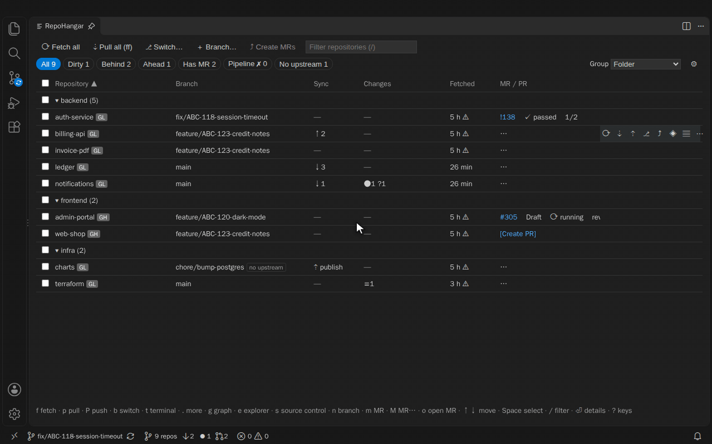
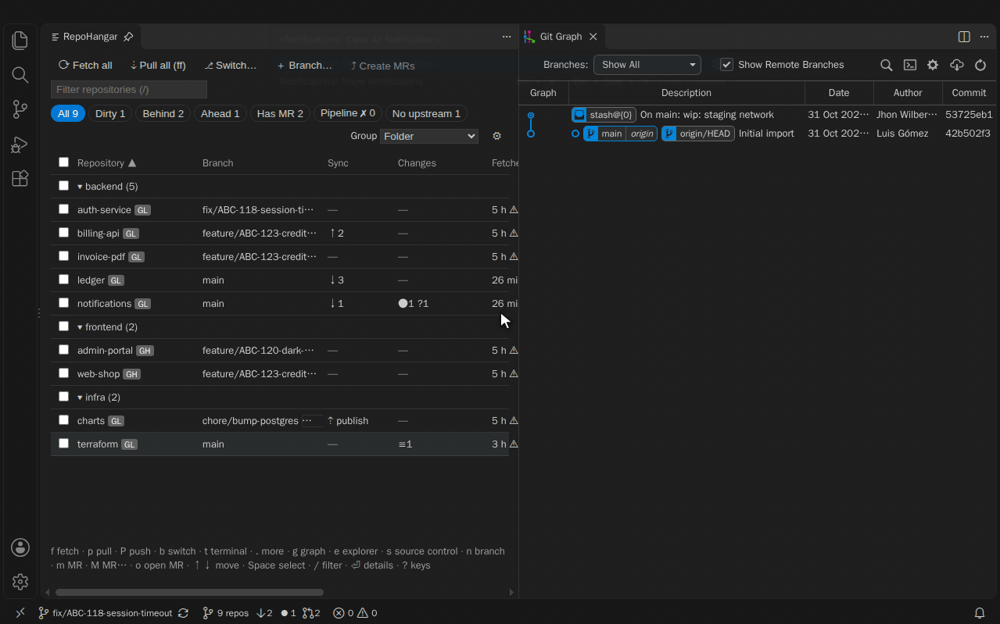

# Git Graph

**Open in Git Graph** opens the [Git Graph](https://marketplace.visualstudio.com/items?itemName=mhutchie.git-graph)
extension switched to the repository. It's available from:

- `g` or the `◈` button on a dashboard row, the row's `⋯` menu and its details;
- the Source Control Repositories menu and the Explorer context menu;
- **RepoHangar: Open in Git Graph** (`Ctrl+Alt+J`, `Ctrl+Cmd+J` on macOS) for the repository of the active editor.

Source Control is shown next to the graph with the same repository selected, and keyboard focus stays on Git Graph.
Turn that off with [`repohangar.gitGraph.revealSourceControl`](../reference/settings.md#repohangar-gitgraph-revealsourcecontrol)
and [`repohangar.gitGraph.syncSourceControlSelection`](../reference/settings.md#repohangar-gitgraph-syncsourcecontrolselection).

## The dashboard beside Git Graph

With the dashboard on one side and Git Graph on the other, each click on a repository name shows that repository's
graph ([`repohangar.dashboard.nameClick`](../reference/settings.md#repohangar-dashboard-nameclick) is `auto` by
default):

## Without Git Graph

Git Graph is optional. Without it, the same items read **Open in Source Control Graph** and open VS Code's built-in
graph. [`repohangar.gitGraph.whenMissing`](../reference/settings.md#repohangar-gitgraph-whenmissing) changes that:

| Value | Without Git Graph |
|---|---|
| `"sourceControlGraph"` (default) | The items open VS Code's Source Control Graph |
| `"offerInstall"` | The items keep reading **Open in Git Graph** and offer to install it |
| `"hide"` | The items are hidden |

RepoHangar installs nothing unless you click **Install Git Graph**. Git Graph (`mhutchie.git-graph`) is an independent
third-party extension not affiliated with RepoHangar and is subject to its own license and terms.

:::note

VS Code's Source Control Graph shows the repository of its own **Repo** picker, so pick the repository there if it
shows another one.

:::
