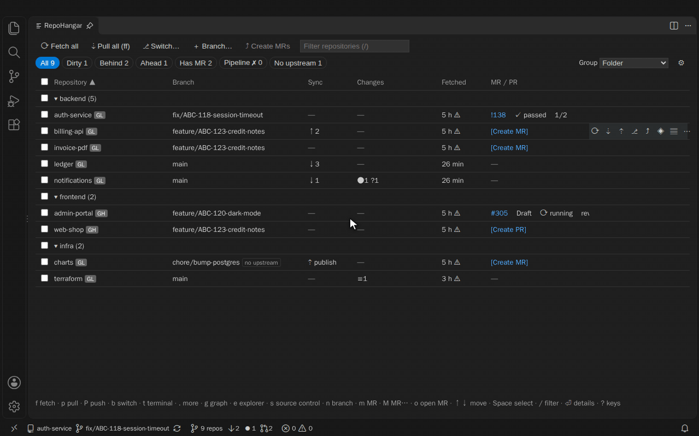

# RepoHangar

**RepoHangar - Multi-Repo Git Dashboard** is a VS Code extension for people who work in many Git repositories at once.
It shows every repository in your workspace at a glance, acts on all of them at once, and opens GitLab merge requests
or GitHub pull requests with your team's defaults in one keystroke.

## What it does

- **One row per repository.** Branch, ahead and behind counts, uncommitted changes, stashes, the age of the last fetch
  and the merge request or pull request of the branch, with its pipeline and approvals. Rows update as soon as Git
  changes; RepoHangar never polls. See [The dashboard](guide/dashboard.md).
- **Act on many repositories at once.** Fetch all, pull all (fast-forward only), switch or create a branch in every
  selected repository, with a result panel that fixes what was skipped. See [Fetch and pull](guide/batch-operations.md)
  and [Branches across repositories](guide/branches.md).
- **Merge requests in one keystroke.** `m` creates the merge request or pull request of a row, filled in from an
  [MR profile](merge-requests/profiles.md): target, title, reviewers, labels, squash. Select several repositories and
  `m` creates one per repository, each linking the others. See
  [Creating merge requests](merge-requests/creating.md).
- **GitLab and GitHub,** including self-hosted GitLab and GitHub Enterprise, through your VS Code account, a token in
  VS Code's secret storage, or your `glab` / `gh` login. See [Status and signing in](merge-requests/status-and-sign-in.md).
- **Git Graph, Explorer and Source Control** one key away for any row. See [Git Graph](integrations/git-graph.md).

:::info[Preview]

RepoHangar is in preview. Dashboard operations, multi-repo branch switching/creation, MR profiles, and single or linked
batch merge/pull request creation are available today; auto-merge follows. See [Getting started](getting-started.mdx)
for installation options.

:::

## Requirements

- VS Code 1.93 or later, with the built-in **Git** extension enabled.
- Git on your `PATH`.
- A [trusted workspace](privacy-and-security.md#workspace-trust). RepoHangar doesn't run in Restricted Mode.
- For merge requests: an account on GitLab 17.10 or later (gitlab.com or self-hosted), or on GitHub or GitHub
  Enterprise.
