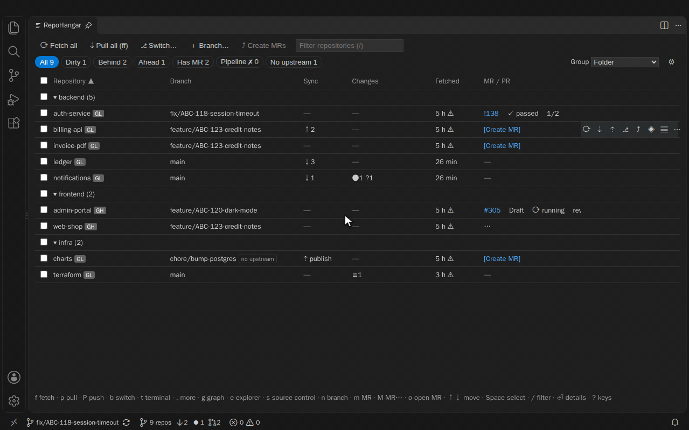

# Creating merge requests



## Start it

Any of these opens the **Create MR drawer** for a repository, every field filled in from its
[MR profile](profiles.md):

- `m` on a dashboard row;
- **[Create MR]** (**[Create PR]** on GitHub) in the row's MR / PR cell, or `⤴` in its hover buttons;
- **RepoHangar: Create Merge Request (Defaults)** (`Ctrl+Alt+M`, `Ctrl+Cmd+M` on macOS) for the repository of the
  active editor;
- **Create MR** in the Source Control Repositories menu, or in the Explorer **RepoHangar** submenu of a GitLab or
  GitHub repository.

Check the fields and press `Ctrl+Enter`.

[`repohangar.mr.quickCreate`](../reference/settings.md#repohangar-mr-quickcreate) changes what those entry points do:

| Value | What happens |
|---|---|
| `"drawer"` (default) | The pre-filled Create MR drawer opens |
| `"confirm"` | A quick input shows the title: `Enter` creates with the title you typed; it also offers **Edit all fields…**, the other profiles and **Create as draft** |
| `"direct"` | It's created with the profile's values and no dialog |

`M` and **RepoHangar: Create Merge Request…** (`Ctrl+Alt+Shift+M`, `Ctrl+Cmd+Shift+M` on macOS) always open the
drawer, opening the dashboard first when it's closed.

## What creating does

1. It asks the host once whether the branch already has a merge request, and opens it instead of creating a
   duplicate.
2. It stops, with a button that fixes it, when the branch isn't ready: an operation in progress, a detached HEAD, the
   target branch itself, nothing to merge, or a remote branch with commits you don't have. Uncommitted files only add
   a warning.
3. It pushes the branch when it has no upstream or is ahead of it (`"pushIfNeeded": false` in the profile stops
   instead).
4. It sends every value in the create request and reports what was applied:

   ```text
   Created !142 in billing-api (pushed 2 commits): reviewers ana.perez, luis.gomez · squash · delete branch
   ```

   with **Open MR**, **Copy link** and **Undo**. Undo closes the merge request within 30 s and keeps the branch.

The Sync cell shows `⟳ creating MR` while it runs; pressing `m` again does nothing.

## The Create MR drawer

The drawer opens beside the grid with: profile, target, title, description, reviewers, assignees, labels, squash,
delete source branch and draft.

- **Recent values.** Under **Reviewers** and **Labels**, `recent: luis.gomez · team:backend` offers the last 10 you
  sent on that host, one click each.
- **User search.** In **Reviewers** and **Assignees**, type part of a name or username and pick from the project's
  users (`Jhon Tapia @jtapia`): `↑` `↓` move, `Enter` or a click adds the username, `Esc` closes the
  list. `Enter` with no match adds what you typed (a leading `@` is dropped), so `team:<slug>` still works on GitHub.
  On GitHub the search matches names as well as logins.
- **Save as defaults ▾** keeps the values that differ from the profile, for you, the workspace or this repository.
  See [MR profiles](profiles.md#save-as-defaults).
- `Ctrl+Enter` creates, `Esc` closes the drawer.

A GitLab project that turns squash off or requires it wins over the profile, and the drawer says so. GitLab Free keeps
one reviewer; RepoHangar reports the ones it couldn't add.

## Open and copy

**RepoHangar: Open Merge Request of Current Branch** opens the merge request of the active editor's repository, and
**Open MR** in the Source Control and Explorer menus does the same for that repository.

To create merge requests in several repositories at once, see
[Merge requests for several repositories](several-repositories.md).
