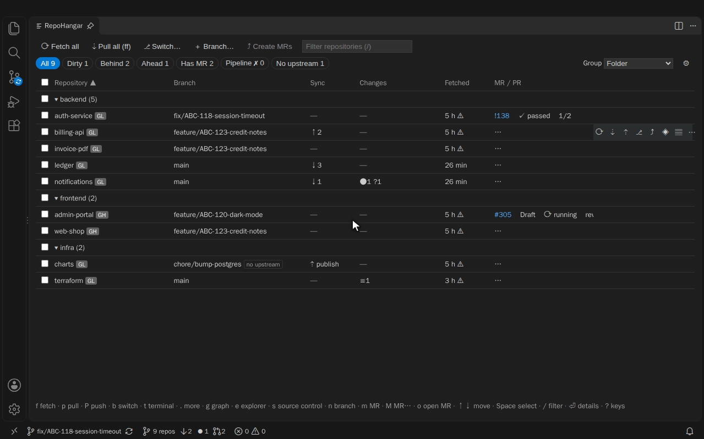

# Merge requests for several repositories



Select the repositories of a feature (filter by its ticket with `/` and press `Ctrl+A`), then press `m`, click
**⤴ Create MRs (3)** in the toolbar, or run **RepoHangar: Create Merge Request (Defaults)** while the dashboard has
rows selected.

RepoHangar creates one merge request or pull request per repository, in parallel, each with the profile its own
[rules](profiles.md#rules) choose and its own checks. A repository that isn't ready is skipped with its reason, and
the others go on. One quick pick lists them all first; with
[`repohangar.mr.quickCreate`](../reference/settings.md#repohangar-mr-quickcreate) set to `"direct"`, they're
created with no dialog.

## Related links

When they're created, each description gets a **Related:** section that links the others, on GitLab and GitHub
alike:

```text
Related:
- ledger !143 https://git.acme.com/payments/ledger/-/merge_requests/143
- web-shop #311 https://github.com/acme/web-shop/pull/311
```

It goes where the description has the `{related}` [placeholder](profiles.md#placeholders), else at the end, between
hidden markers, so creating the set again replaces it instead of adding a second one. A review that already existed
is linked too; one created on GitLab [without a token](gitlab-without-token.md) is not.

## The result panel

The result panel lists every repository:

```text
✓ billing-api  !142  git.acme.com/payments/billing-api  (pushed 2)
```

with **Open ↗**, **Copy all links**, **Retry failed** for the ones that failed (which links all of them again), and
**Close**.
